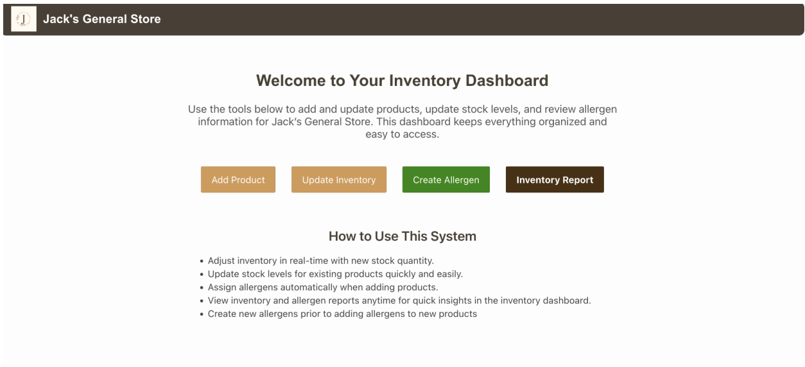
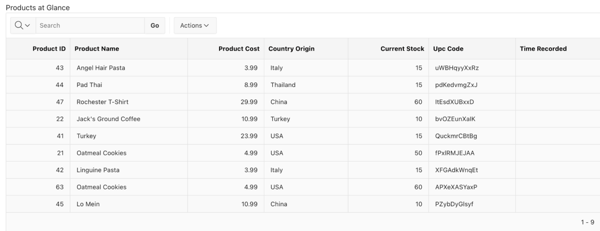
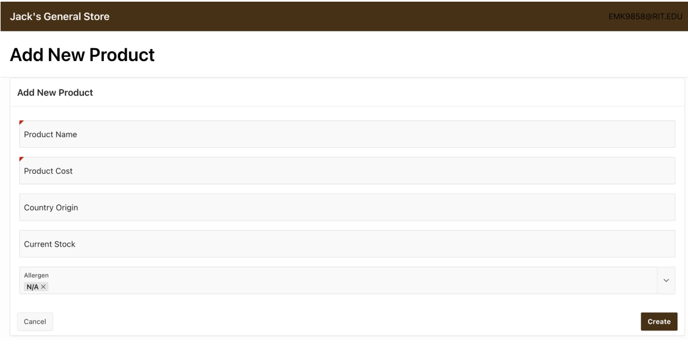
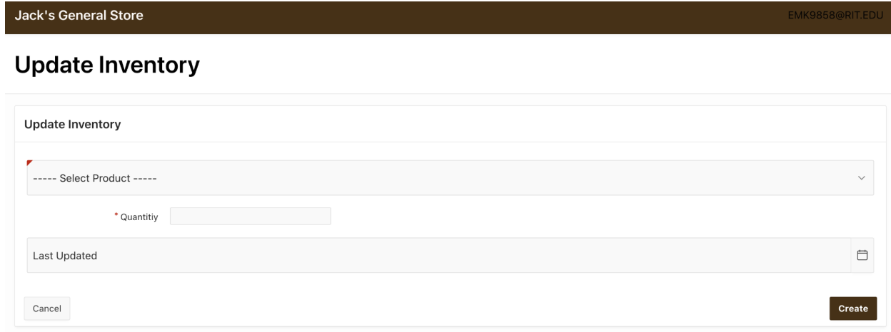
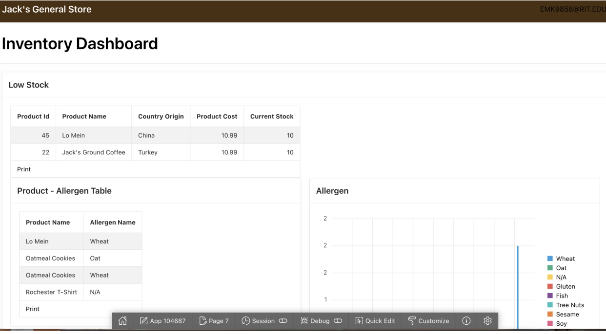
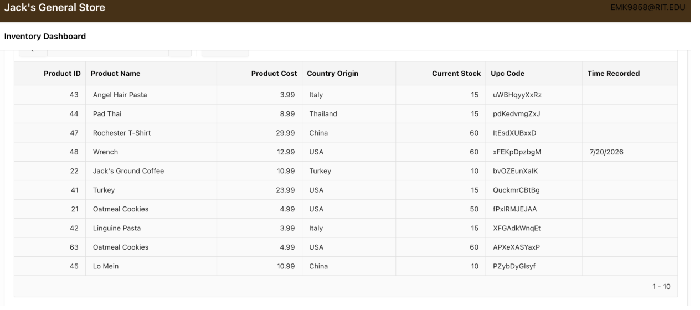
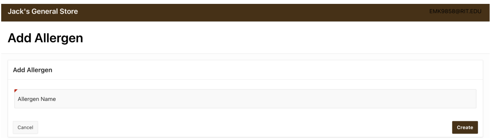

## Project Description
This project involved designing and implementing a relational inventory management system for a simulated small retail business using SQL and Oracle APEX. The system enables inventory tracking, product management, allergen monitoring, and reporting functionalities through an interactive web-based application. The project applied database design principles, normalization techniques, and user-centered interface development to address common inventory management challenges faced by small businesses

## Project Deliverables 
- Create a database schema for the inventory management system, including tables for products, inventory, and sales. 
- Provide a user-friendly interface for store employees to add, update, and delete product information.
- Implement a reporting system that allows the store manager to generate reports on sales and inventory trends. 

## Technical Design and Implementation 
The system was built using Oracle SQL and Oracle APEX and included:

- Product table
- Inventory table
- Sales table
- Allergen table
- Product-Allergen junction table

The database design enforced referential integrity through primary and foreign key relationships while supporting inventory tracking and reporting functionalities. 

## Project Outcomes 

The completed application allows store employees to efficiently manage product information, track inventory levels, and generate sales reports. The system's user-friendly interface and robust database design contribute to improved operational efficiency and data accuracy for the simulated retail business. 

::: {.grid}

::: {.g-col-3}

:::

::: {.g-col-3}

:::

::: {.g-col-3}

:::

::: {.g-col-3}

:::

::: {.g-col-3}

:::

::: {.g-col-3}

:::

::: {.g-col-3}

:::

:::
## Project Assumptions 
- 10 data projects are provided for this demonstration 
- All data constraints and primary keys are met and assumed to be unique or auto-generated
- Automated data storage is provided when the new product is recorded in the new product intake, including allergens and inventory.
- Products can have multiple allergens. Inventory is assumed to reference one product. 
- Queries are valid and assumed
- The business manager must manually change any allergen to any product by filling out a new allergen form and a new product intake, then the inventory dashboard is recorded based on recency. 
- The inventory table records all inventory transactions, meaning all products are recounted on each inventory-recording day.

## Project Limitations 
 - One technical challenge involved automating updates between the product-allergen junction table and related inventory forms within Oracle APEX. To maintain data integrity, an alternative workflow was implemented that allowed managers to manually update allergen information while ensuring the inventory dashboard reflected the most recent records.
 - This challenge strengthened my understanding of many-to-many database relationships, junction tables, and form automation within database-driven applications.

